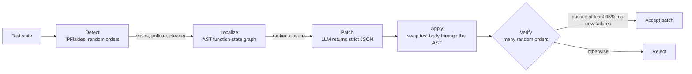

# RepoGraph-NIO (LLM4Flakies)

**Graph-guided, verification-first LLM repair for order-dependent flaky tests in Python repositories.**

Order-dependent (OD) tests pass alone and fail when another test runs first, because the earlier test changed shared state (a global, a cache, a registry) and never reset it. The failing test looks fine; the bug lives somewhere else. Rule-based tools such as [iPFlakies](https://github.com/iDFlakies/iPFlakies) detect these tests but repair only about a third of them.

This project pairs iPFlakies detection with an LLM repair loop that is constrained by a small static-analysis graph and only accepts a patch after it survives many randomized test orders.

- **Paper:** [`Repograph Paper .pdf`](<./Repograph Paper .pdf>) (Archit Shukla and Varun Raghavendra, University of Colorado Boulder)

## Results

Evaluated on the reproduced Gruber et al. OD corpus: 610 repository snapshots in a Python 3.8.12 container, 392 of which ran, yielding 1,978 validated OD failures, of which 537 were evaluated.

| | Repaired (of 537) |
| --- | --- |
| iPFlakies rule-based repair | 175 (33%) |
| LLM4Flakies (GPT-5) | 180 (33.5%) |
| Fixed by both | 51 |
| Fixed only by LLM4Flakies | 129 |
| Fixed only by iPFlakies | 124 |

- Run together, the two approaches cover **304 of 537 tests (56.6%)**, because the LLM fixes cases that templates cannot touch.
- **Graph ablation (GPT-5):** localization lifts repairs from 21.4% to 33.5%, and shrinks prompts by 30 to 40%.
- **Regressions:** 0% with GPT-5, 0.37% with GPT-4o mini, 2.2% with GPT-5.1 Codex mini.

| Model | Median latency | P90 latency | Approx. cost per fix |
| --- | --- | --- | --- |
| GPT-4o mini | 4.8 s | 9.4 s | $0.002 |
| GPT-5.1 Codex mini | 31.9 s | 125 s | $0.04 |
| GPT-5 | 62.4 s | 130 s | $0.06 |

## How it works

1. **Detect.** iPFlakies runs the suite in hundreds of random orders and labels each test as a *victim* (its result flips), a *polluter* (breaks a victim), or a *cleaner* (resets state). These labels are treated as ground truth.
2. **Localize.** The test file is parsed into an AST and turned into a bipartite graph: one side is functions and tests, the other is shared state (globals, attributes, registries), with read and write edges between them. From the failing test, a ranked closure collects the state it reads, the functions that write that state, and the functions that read what those wrote, expanding until nothing new appears.
3. **Patch.** Only the closure goes to the LLM, which must return strict JSON with `test_name` and `replacement_block` (the full new test body). Code locates the test in the AST and swaps the body in; more than 95% of accepted patches applied cleanly. Only the failing test is edited, never production code. A typical fix is a state reset at the start of the test.
4. **Verify.** The patched test runs across many random orders. A patch is accepted only if it passes at least 95% of runs with no new failures. A patch that passed once is never trusted.

## Design choices

- **Verification first.** One-shot LLM edits are unreliable, so every patch has to earn acceptance through repeated randomized runs.
- **Structured context instead of whole files.** Handing the model a compact, high-signal closure reduces hallucinated edits and token cost.
- **Test-only edits.** The pipeline never touches production code, which keeps patches small, reviewable, and reversible.
- **Benchmark choice.** Evaluated on the Gruber et al. flaky-test corpus, which has known ground truth for OD failures.

## Authors

Archit Shukla and Varun Raghavendra, University of Colorado Boulder.
